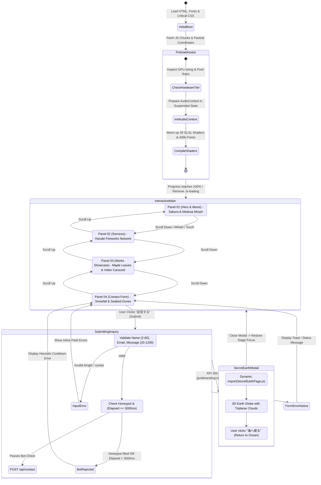

# 02_AppFlow.md – Application Flow & State Machine
## Project: Next Label Portfolio
**Version:** 1.0.0  
**Status:** Approved / Architecture-Locked  

---

## 1. Global State Machine & Lifecycle Architecture

The application operates as a single-page reactive state machine orchestrating three parallel lifecycles: **DOM Scroll State**, **Three.js WebGL Stage Lifecycle**, and **Web Audio Pipeline**.

---

## 2. Navigation Routes & URL Schemas

| Route / Parameter | Type | Purpose & Behavior |
| :--- | :--- | :--- |
| `/` | Page Route | Canonical single-page experience containing all 5 thematic panels. |
| `/#top` or `/#hero` | Hash Anchor | Scrolls viewport smoothly to Spring Hero section. |
| `/#about` | Hash Anchor | Scrolls viewport to About narrative panel. |
| `/#services` | Hash Anchor | Scrolls viewport to Summer Services panel. |
| `/#works` | Hash Anchor | Scrolls viewport to Autumn Featured Works showcase. |
| `/#contact` | Hash Anchor | Scrolls viewport to Winter Inquiry Form. |
| `?lite=1` | Query Param | Forces low-tier rendering: 102k particles, disables heavy post-processing shaders. |
| `?capture=1` | Query Param | Locks framerate to deterministic intervals for video capture / screenshot recording. |
| `/api/contact` | API Route | Edge Serverless endpoint accepting `POST` JSON payloads. |
| `/robots.txt` | Static Document | Search crawler guidance pointing to sitemap. |
| `/sitemap.xml` | Static Document | SEO index containing canonical URL mapping. |

---

## 3. Screen-by-Screen Component Interactions

### 3.1 Initial Loading Screen (`.loader`)
- **Initial View:** Minimalist dark canvas showing procedural loading motif (`[data-loader-motif]`), active particle count ticker (`0 -> 409,600`), and depth gauge.
- **Button / Interaction:** Automatic transition when resources resolve. If asset loading exceeds 4 seconds, gracefully fallback to default interactive state.

### 3.2 Masthead & Global Controls
- **Brand Logo (`.masthead__brand`):** Clicks navigate smoothly to `#top`.
- **Sound Toggle (`[data-audio-toggle]`):**
  - *Click when muted:* Transitions icon to active sound waves; fades in audio from 0 to 1 over 800ms.
  - *Click when playing:* Transitions icon to muted state; fades out audio to 0 over 400ms.
- **Navigation Links (`About`, `Services`, `Works`, `Contact`):**
  - Smooth scroll with GSAP scroll hijacking and depth offset.
  - Current active section highlights with seasonal color indicator (`春`, `夏`, `秋`, `冬`).

### 3.3 Autumn Works Carousel (`.panel--works`)
- **Work Items (7 Items):** `TO PLACE`, `IWAKIKI`, `NEXT`, `TRANS B`, `LUZ REAL`, `HAND`, `FUNKY`.
- **Hover / Pointer Over:**
  - Activates floating video preview (`.mp4` streams automatically).
  - Triggers shader disturbance uniform `uWarp` on background canvas.
  - Updates role, client highlights, and tech stack tags.
- **Click Action:** Opens the verified client URL in a new sandboxed tab (`target="_blank" rel="noopener noreferrer"`).

### 3.4 Winter Contact Form (`.panel--contact`)
- **Fields:**
  - `name`: Real-time character count (2-60).
  - `email`: RFC 5322 regex validation.
  - `message`: Multiline textarea (20-1200 characters).
  - `company_website`: Honeypot input (visually hidden, excluded from screen readers via `aria-hidden="true"`).
- **Submit Action (`[data-submit]`):**
  - Disables button and applies `aria-busy="true"`.
  - Displays progress indicator: *"送信しています…"*.
  - AbortController terminates requests exceeding 15 seconds.

### 3.5 Secret Earth Easter Egg Dialog (`[data-secret-earth]`)
- **Trigger:** Dispatched by custom event `junkbranding:reveal-earth` upon HTTP 200 from `/api/contact`.
- **State Transition:**
  1. Main stage pauses rendering (`H_.stop()`).
  2. Dialog opens with `aria-modal="true"`.
  3. Dynamic chunk `SecretEarthPage.js` loads asynchronously.
  4. Renders 3D Earth globe rotating with triplanar FBM procedural clouds and atmospheric fresnel rim.
  5. Close button (`data-earth-close` - *"海へ戻る"*): Dismisses dialog, resumes primary ocean stage, and returns keyboard focus to the submit button.

---

## 4. Error, Empty, and Edge-Case State Handling

| Failure / Edge Scenario | Detection Trigger | Recovery & Fallback Action |
| :--- | :--- | :--- |
| **WebGL Context Lost** | `webglcontextlost` on canvas | Catches event, calls `preventDefault()`, dispatches `junkbranding:gl-lost`, and displays clean CSS gradient backdrop without crashing UI. |
| **Prefers Reduced Motion** | `window.matchMedia('(prefers-reduced-motion: reduce)')` | Disables particle angular velocity, halts screen warp distortion, and replaces kinetic typography translation with instant alpha fades. |
| **Low-End Mobile Device** | GPU benchmark $< 25\text{fps}$ during warmup | Automatically switches to `tier: 'low'`: decreases particle allocation to $102,400$, scales down render target to $0.75\times$. |
| **Bot / Rapid Submissions** | Form submit within $< 3000\text{ms}$ or honeypot filled | Silently drops backend dispatch; displays friendly anti-spam notification: *"少し時間をおいてから、もう一度お試しください。"* |
| **Network Failure during Contact** | `fetch()` throws `TypeError` or 15s timeout | Displays offline alert: *"通信エラーが発生しました。接続をご確認の上、再送信してください。"* Input values are preserved in DOM. |
| **Background Tab Inactivity** | `document.visibilityState === 'hidden'` | Halts WebGL `requestAnimationFrame` loop and mutes Web Audio to consume 0% background battery and CPU. |
