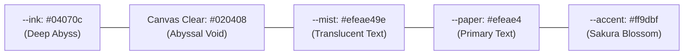

# 03_UI_Spec.md – Visual Design System & UI Specification
## Project: Next Label Portfolio
**Version:** 1.0.0  
**Status:** Approved / Architecture-Locked  

---

## 1. Design Philosophy & Aesthetic Tokens

The design language embodies **Japanese digital minimalism** fused with **deep-sea abyss aesthetics**:
- **Palette Mood:** Deep oceanic trench navy, muted silk paper, bioluminescent seafoam, and sakura blossom accents.
- **Atmosphere:** Low-contrast dark elegance where typography emerges smoothly from the dark canvas like underwater light.



---

## 2. Color Palette & Exact Hex Tokens

| Token Variable | Hex / RGBA Value | Role & Usage |
| :--- | :--- | :--- |
| `--ink` | `#04070c` | Deep background tone for panels and UI surfaces. |
| `--paper` | `#efeae4` | Primary high-contrast text color; silk off-white. |
| `--mist` | `#efeae49e` (`rgba(239, 234, 228, 0.62)`) | Secondary text, subheadings, metadata, and labels. |
| `--faint` | `#efeae433` (`rgba(239, 234, 228, 0.20)`) | Structural borders, subtle dividers, and input borders. |
| `--accent` | `#ff9dbf` | Accent pink (Sakura blossom, active focus outlines, hover highlights). |
| `--canvas-clear` | `#020408` (`0x020408`) | WebGL renderer background clear color. |
| `--caustic-tint` | `#197898` / `#081a26` | Underwater light caustics and sand dunes highlight. |
| `--bubble-glow` | `#d8f2ff` | Bioluminescent rim highlight for procedural bubbles. |
| `--error` | `#ff6b6b` | Inline form validation error messages and error states. |
| `--success` | `#4ecdc4` | Success status messages and confirmation indicators. |

---

## 3. Typography Hierarchy & Font Scales

### 3.1 Font Families
```css
:root {
  --font-mincho: "Shippori Mincho", "Hiragino Mincho ProN", "Yu Mincho", serif;
  --font-sans: "Zen Kaku Gothic New", "Hiragino Sans", "Yu Gothic", sans-serif;
  --font-serif: "Instrument Serif", "Times New Roman", serif;
}
```

### 3.2 Fluid Typographic Scale Formulas

| Hierarchy Role | Font Family | Size Formula (`clamp`) | Weight | Line Height | Letter Spacing |
| :--- | :--- | :--- | :--- | :--- | :--- |
| **Hero Statement** | `var(--font-mincho)` | `clamp(28px, 4.2vw, 56px)` | 600 | 1.45 | `0.04em` |
| **Panel Heading (H2)** | `var(--font-mincho)` | `clamp(24px, 3.2vw, 42px)` | 600 | 1.40 | `0.03em` |
| **Work Title (H4)** | `var(--font-serif)` | `clamp(22px, 2.5vw, 36px)` | 400 | 1.20 | `0.02em` |
| **Subheadings / Lead** | `var(--font-sans)` | `clamp(16px, 1.8vw, 22px)` | 400 | 1.70 | `0.02em` |
| **Body Paragraph** | `var(--font-sans)` | `clamp(14px, 1.2vw, 17px)` | 400 | 1.85 | `0.03em` |
| **Labels & Season Tags** | `var(--font-sans)` | `clamp(11px, 0.9vw, 13px)` | 500 | 1.20 | `0.15em` (Caps) |
| **Indices & Numbers** | `var(--font-serif)` | `clamp(18px, 2.0vw, 28px)` | 400 | 1.00 | `0.01em` |

---

## 4. Spacing, Layout Grid & Geometry Rules

```css
:root {
  --margin: clamp(22px, 3.6vw, 60px);
  --top: clamp(92px, 14vh, 140px);
  --bottom: clamp(32px, 6.5vh, 68px);
  --lane: 112px;
  --max-content-width: 1320px;
}
```

### 4.1 Layout Constraints
- **Full Viewport Paneling:** Each seasonal panel (`.panel`) occupies a minimum of `100vh` (with `100dvh` support for mobile browsers).
- **Z-Index Layering Scale:**
  - `z-index: 1`: WebGL 3D Background Canvas (`.stage`).
  - `z-index: 10`: DOM Panel Content & Parallax Typography.
  - `z-index: 50`: Persistent Masthead & Audio Toggle.
  - `z-index: 90`: Floating Video Preview & Tooltips.
  - `z-index: 100`: Initial Screen Loader (`.loader`).
  - `z-index: 200`: Secret Earth Modal Dialog (`.secret-earth`).

---

## 5. Core UI Component Specifications & States

### 5.1 Interactive Pill Button (`.pill`)
Used for form submission (`data-submit`), sound toggling, and modal actions:
```css
.pill {
  display: inline-flex;
  align-items: center;
  justify-content: center;
  padding: 12px 28px;
  border-radius: 9999px;
  font-family: var(--font-sans);
  font-size: 13px;
  letter-spacing: 0.08em;
  transition: all 0.35s cubic-bezier(0.16, 1, 0.3, 1);
}
```
- **States:**
  - **Default:** Transparent background, `1px solid var(--faint)`, color `var(--paper)`.
  - **Hover:** Border color transitions to `var(--accent)`, subtle pink glow box-shadow `0 0 20px rgba(255, 157, 191, 0.25)`.
  - **Active:** Scale down to `0.97`, background `rgba(255, 157, 191, 0.12)`.
  - **Focus-Visible:** Outline `2px solid var(--accent)` with `4px` offset.
  - **Disabled / Busy:** Opacity `0.45`, cursor `not-allowed`, spinner animation.

### 5.2 Seasonal Label Badge (`.label`)
- **Structure:** Contains small kanji icon for season (`春`, `夏`, `秋`, `冬`) followed by section title (e.g. `春 About`).
- **Underline Animation:** Connected to GSAP timeline via `--line: 0 -> 1` scaleX transform on `:after` pseudo-element.

### 5.3 Form Field Inputs (`.form__field`)
- **Container:** Dark translucent pill or minimalist border bottom.
- **States:**
  - **Default:** `border: 1px solid var(--faint)`, background `rgba(4, 7, 12, 0.6)`.
  - **Focus:** `border-color: var(--paper)`, subtle inner light.
  - **Invalid:** `border-color: var(--error)`, inline error message appears below with slide-down reveal.

### 5.4 3D Floating Work Card (`.works__card`)
- **Layout:** High-contrast typography left, floating video stream canvas right.
- **Hover Reaction:** Video scales from `0.98` to `1.03` with smooth ease; background WebGL shader ripples in sync.
