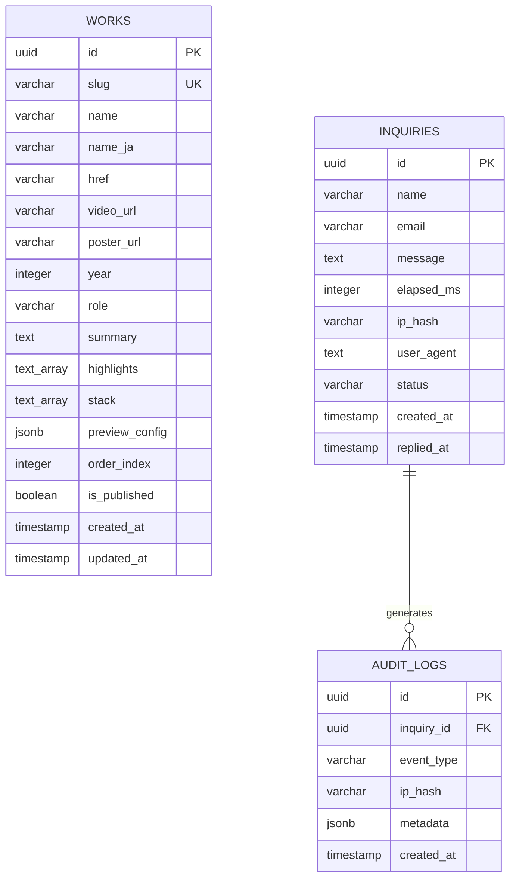

# 05_Schema.md – Relational Database Schema & Security Architecture
## Project: Next Label Portfolio
**Database Engine:** PostgreSQL 16+ (Supabase / Neon)  
**ORM:** Drizzle ORM / Supabase Client  
**Version:** 1.0.0  
**Status:** Approved / Architecture-Locked  

---

## 1. Entity Relationship Diagram (ERD)



---

## 2. PostgreSQL DDL & Table Specifications

```sql
-- Enable UUID extension
CREATE EXTENSION IF NOT EXISTS "uuid-ossp";

-- ============================================================================
-- 1. TABLE: works (Portfolio Showcase Projects)
-- ============================================================================
CREATE TABLE public.works (
    id UUID PRIMARY KEY DEFAULT uuid_generate_v4(),
    slug VARCHAR(64) UNIQUE NOT NULL,
    name VARCHAR(120) NOT NULL,
    name_ja VARCHAR(150),
    href VARCHAR(512) NOT NULL,
    video_url VARCHAR(512),
    poster_url VARCHAR(512),
    year SMALLINT NOT NULL CHECK (year >= 2020 AND year <= 2035),
    role VARCHAR(100) NOT NULL,
    summary TEXT NOT NULL,
    highlights TEXT[] NOT NULL DEFAULT '{}',
    stack TEXT[] NOT NULL DEFAULT '{}',
    preview_config JSONB DEFAULT '{"highlightReduction": 0.16, "edgeGlow": 0.6}'::jsonb,
    order_index INTEGER NOT NULL DEFAULT 0,
    is_published BOOLEAN NOT NULL DEFAULT true,
    created_at TIMESTAMPTZ NOT NULL DEFAULT timezone('utc', now()),
    updated_at TIMESTAMPTZ NOT NULL DEFAULT timezone('utc', now())
);

-- Indexes for performance
CREATE INDEX idx_works_published_order ON public.works (is_published, order_index ASC);
CREATE INDEX idx_works_slug ON public.works (slug);

-- ============================================================================
-- 2. TABLE: inquiries (Contact Ingestion & Client Consultation)
-- ============================================================================
CREATE TABLE public.inquiries (
    id UUID PRIMARY KEY DEFAULT uuid_generate_v4(),
    name VARCHAR(60) NOT NULL CHECK (char_length(name) >= 2),
    email VARCHAR(254) NOT NULL CHECK (email ~* '^[A-Za-z0-9._%+-]+@[A-Za-z0-9.-]+\.[A-Za-z]{2,}$'),
    message TEXT NOT NULL CHECK (char_length(message) >= 20 AND char_length(message) <= 1200),
    elapsed_ms INTEGER NOT NULL CHECK (elapsed_ms >= 3000), -- Anti-bot threshold
    ip_hash VARCHAR(64) NOT NULL, -- SHA-256 hashed client IP for privacy preservation
    user_agent TEXT,
    status VARCHAR(20) NOT NULL DEFAULT 'pending' CHECK (status IN ('pending', 'reviewed', 'replied', 'spam')),
    created_at TIMESTAMPTZ NOT NULL DEFAULT timezone('utc', now()),
    replied_at TIMESTAMPTZ
);

-- Indexes for inquiries
CREATE INDEX idx_inquiries_status_created ON public.inquiries (status, created_at DESC);
CREATE INDEX idx_inquiries_ip_hash_created ON public.inquiries (ip_hash, created_at DESC);

-- ============================================================================
-- 3. TABLE: audit_logs (Security, Bot Tracking & Event Audit)
-- ============================================================================
CREATE TABLE public.audit_logs (
    id UUID PRIMARY KEY DEFAULT uuid_generate_v4(),
    inquiry_id UUID REFERENCES public.inquiries(id) ON DELETE SET NULL,
    event_type VARCHAR(50) NOT NULL,
    ip_hash VARCHAR(64) NOT NULL,
    metadata JSONB DEFAULT '{}'::jsonb,
    created_at TIMESTAMPTZ NOT NULL DEFAULT timezone('utc', now())
);

CREATE INDEX idx_audit_logs_event_created ON public.audit_logs (event_type, created_at DESC);
```

---

## 3. Row-Level Security (RLS) & Zero-Trust Access Control

To comply with our **Backend Default-Deny** security harness, Row-Level Security is strictly enabled on all tables:

```sql
-- Enable RLS across all tables
ALTER TABLE public.works ENABLE ROW LEVEL SECURITY;
ALTER TABLE public.inquiries ENABLE ROW LEVEL SECURITY;
ALTER TABLE public.audit_logs ENABLE ROW LEVEL SECURITY;

-- ----------------------------------------------------------------------------
-- Policies for 'works'
-- ----------------------------------------------------------------------------
-- Public anonymous visitors can only read published portfolio works
CREATE POLICY "Public visitors can view published works"
    ON public.works
    FOR SELECT
    TO anon, authenticated
    USING (is_published = true);

-- Only backend service_role can insert, update, or delete portfolio works
CREATE POLICY "Service role full access on works"
    ON public.works
    FOR ALL
    TO service_role
    USING (true)
    WITH CHECK (true);

-- ----------------------------------------------------------------------------
-- Policies for 'inquiries'
-- ----------------------------------------------------------------------------
-- Public anonymous visitors can INSERT an inquiry through the API
CREATE POLICY "Public visitors can submit inquiries"
    ON public.inquiries
    FOR INSERT
    TO anon, authenticated
    WITH CHECK (true);

-- Public visitors CANNOT read inquiries under any circumstance
CREATE POLICY "Public visitors cannot read inquiries"
    ON public.inquiries
    FOR SELECT
    TO anon, authenticated
    USING (false);

-- Only backend service_role can view or update inquiries
CREATE POLICY "Service role full access on inquiries"
    ON public.inquiries
    FOR ALL
    TO service_role
    USING (true)
    WITH CHECK (true);

-- ----------------------------------------------------------------------------
-- Policies for 'audit_logs'
-- ----------------------------------------------------------------------------
-- Deny all public access to audit logs; service_role only
CREATE POLICY "Service role exclusive access on audit_logs"
    ON public.audit_logs
    FOR ALL
    TO service_role
    USING (true)
    WITH CHECK (true);
```

---

## 4. Initial Seed Data (Verified Next Label Showcase)

```sql
INSERT INTO public.works (slug, name, name_ja, href, video_url, poster_url, year, role, summary, highlights, stack, order_index)
VALUES
(
    'to-place',
    'TO PLACE',
    NULL,
    'https://to-place.co.jp/',
    '/videos/toplace.mp4',
    NULL,
    2025,
    'Design, Development',
    '住空間の写真を主役にした、住まいの企業のコーポレートサイト。',
    ARRAY['大きな写真で空間を伝えるレイアウト', 'スクロールに合わせた見出しの演出'],
    ARRAY['HTML / CSS', 'JavaScript', 'GSAP'],
    1
),
(
    'iwakiki',
    'IWAKIKI',
    NULL,
    'https://d2crmzpw5das9r.cloudfront.net/',
    '/videos/iwakiki.mp4',
    NULL,
    2025,
    'Design, Development',
    '福島県いわき市の不動産会社サイト。「縁結び」を大胆な文字組みで。',
    ARRAY['画面いっぱいの文字と写真の重ね合わせ', '縦書きの案内タブ'],
    ARRAY['HTML / CSS', 'JavaScript', 'AWS CloudFront'],
    2
),
(
    'next',
    'NEXT',
    NULL,
    'https://next-inc.group/',
    '/videos/next.mp4',
    NULL,
    2024,
    'Design, Development',
    '事業ポートフォリオを伝える、株式会社NEXTのコーポレートサイト。',
    ARRAY['夜景と光の粒で「実体経済」を表すビジュアル', '事業ごとの構成'],
    ARRAY['HTML / CSS', 'JavaScript', 'Canvas'],
    3
),
(
    'trans-b',
    'TRANS B',
    NULL,
    'https://trans-b.vercel.app/',
    '/videos/trans.mp4',
    NULL,
    2025,
    'Design, 3D, Development',
    '物流企業のサイト。夜の道路を走る3D演出とキネティックタイポ。',
    ARRAY['夜の道路を進むリアルタイム3D', 'スクロールで切り替わる事業紹介'],
    ARRAY['Three.js', 'WebGL', 'GSAP', 'Vercel'],
    4
),
(
    'luz-real',
    'LUZ REAL',
    NULL,
    'https://luz-real.com/',
    '/videos/luzreal.mp4',
    NULL,
    2024,
    'Design, Development',
    '都心4区の不動産会社サイト。音楽とともに物件の世界観を伝える。',
    ARRAY['音楽のオン・オフ切り替え', 'モノクロ写真と余白で見せる構成'],
    ARRAY['HTML / CSS', 'JavaScript', 'Web Audio'],
    5
),
(
    'hand',
    'HAND',
    'Next Label Hand Version',
    'https://hand.imranhossain.dev/',
    NULL,
    '/videos/hand.jpg',
    2026,
    'Concept, Design, Development',
    '「眺めるWebから、入り込むWebへ。」体験型のWeb制作を、そのまま体験として見せる自社サイト。手の動きでも操作できる。',
    ARRAY['カメラで手の動きを認識して操作する Hand Mode', '入口で Hand Mode と Mouse Mode を選べる', '夜の海の音楽とともに進む構成'],
    ARRAY['Hand tracking', 'Camera API', 'Web Audio'],
    6
),
(
    'funky',
    'FUNKY',
    'Next Label Funky Version',
    'https://funky.imranhossain.dev/',
    '/videos/junk.mp4',
    NULL,
    2025,
    'Branding, Design, Development',
    '散らばる文字と立体ロゴで「ジャンク」を表現した、もう一つの自社サイト。',
    ARRAY['音楽あり・なしを選んで始めるローディング', 'キーボード操作・スクリーンリーダー・モーション削減への配慮', 'llms.txt などAI検索を意識した設計'],
    ARRAY['Next.js', 'React', 'WebGL'],
    7
);
```
