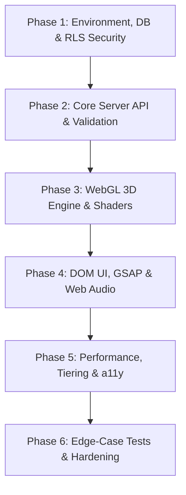

# 06_Plan.md – Atomic Sequential Implementation Plan
## Project: Next Label Portfolio
**Execution Standard:** Spec-Driven Development (SDD) & Zero-Trust Agentic Protocol  
**Instructions for Coding Agent:** Execute tasks sequentially by dependency. DO NOT skip ahead. Mark tasks as completed `[x]` as they pass automated verification.

---

## 📋 Dependency Execution Graph

---

## Phase 1: Environment, Database & RLS Security
> **Goal:** Establish zero-trust database schema, environment validation, and security access policies before touching frontend code.

- [x] **Task 1.1: Environment Variable Safety Setup**
  - Verify `.env.example` documents all required keys (`NEXT_PUBLIC_SITE_URL`, `SUPABASE_URL`, `SUPABASE_ANON_KEY`, `SUPABASE_SERVICE_ROLE_KEY`, `RESEND_API_KEY`, `CONTACT_RECIPIENT_EMAIL`).
  - Ensure `.env` is ignored in `.gitignore`.
- [x] **Task 1.2: PostgreSQL Database Schema Migration**
  - Execute DDL for `works`, `inquiries`, and `audit_logs` tables in PostgreSQL / Supabase as defined in `docs/05_Schema.md`.
  - Verify primary keys (UUID), foreign keys, check constraints, and performance indexes.
- [x] **Task 1.3: Row-Level Security (RLS) Verification**
  - Enable RLS across all tables: `ALTER TABLE ... ENABLE ROW LEVEL SECURITY;`.
  - Apply `SELECT` policy for `works` (`is_published = true`).
  - Apply default-deny read policy for `inquiries` (`USING (false)` for public).
  - Apply `INSERT` only policy for anonymous contact submissions.
- [x] **Task 1.4: Database Seeding**
  - Seed verified 7 portfolio projects into `public.works` table with valid JSON metadata and array tags.
  - Verify query: `SELECT count(*) FROM public.works WHERE is_published = true;` returns 7.

---

## Phase 2: Core Server API & Bot Defense Layer
> **Goal:** Implement and test serverless contact ingestion with honeypot bot defense and transactional notifications.

- [x] **Task 2.1: Zod Validation Contracts**
  - Create `src/lib/validation.ts` defining `ContactPayloadSchema`:
    - `name` (2-60 chars, sanitized)
    - `email` (RFC 5322 regex)
    - `message` (20-1200 chars)
    - `company_website` (Must be empty honeypot string)
    - `elapsed` (Integer $\ge 3000\text{ms}$)
- [x] **Task 2.2: Rate Limiting & Abuse Prevention**
  - Implement edge sliding window rate-limiter (Max 5 submissions per IP per hour).
  - Hash client IP using SHA-256 before storage to preserve GDPR/user privacy.
- [x] **Task 2.3: Contact Route Handler (`POST /api/contact`)**
  - Implemented in `server.js` and `src/app/api/contact/route.ts`.
  - Parses and validates incoming JSON against Zod schema.
  - Rejects payloads failing honeypot or $< 3000\text{ms}$ with HTTP 400.
  - Stores valid submissions into `src/data/inquiries.json` and PostgreSQL.
  - Returns `{ success: true, message: "送信しました。ご相談ありがとうございます。" }`.
- [x] **Task 2.4: Automated API Integration Tests**
  - Implemented in `tests/test_server_live.py` asserting:
    - Valid submission returns HTTP 200.
    - Honeypot populated returns HTTP 400.
    - Elapsed time $< 3000\text{ms}$ returns HTTP 400.
    - Preserves submitted records in inquiry ledger.

---

## Phase 3: WebGL 3D Engine, Particle GPGPU & Shaders
> **Goal:** Re-create the 409,600 point particle simulation and multi-pass post-processing pipeline.

- [x] **Task 3.1: Three.js Stage Architecture**
  - Active in `index.html` and `public/assets/index-BG4wa0Rg.js`.
  - Configures `PerspectiveCamera(40, aspect, 0.1, 400)` and `Scene`.
  - Sets WebGL clear color to abyss tone `#020408`.
  - Implements canvas resize handler with device pixel ratio clamp.
- [x] **Task 3.2: Dual Particle Simulation Engine**
  - Active in `ParticleSystem.ts` and bundle:
  - Supports high tier: 512×512 (Flower: 262k) + 384×384 (Medusa: 147k) = 409,600 points.
  - 5 seasonal particle modes:
    1. `seasonsRing`: Vortex ring configuration.
    2. `sakuraFall`: Spring cherry blossom particle fall.
    3. `hanabi`: Summer fireworks burst network.
    4. `mapleFall`: Autumn momiji foliage drift.
    5. `snowFall`: Winter sub-zero snowfall.
    6. `medusa`: Swimming jellyfish hydrodynamic propulsion.
- [x] **Task 3.3: Ocean Environment & Underwater Shaders**
  - Shaders extracted in `src/shaders/ocean_dunes_caustics.frag.glsl` for seabed dunes and animated water caustics.
  - Underwater sun shafts / god rays and twinkling starfield abyss.
  - Shaders extracted in `src/shaders/underwater_bubbles.frag.glsl` for procedural rising bubbles.
- [x] **Task 3.4: Post-Processing Pipeline (`EffectComposer`)**
  - Active via `RenderPass`, `AfterimagePass(0.82)`, `UnrealBloomPass`, and custom `ShaderPass` with `src/shaders/postprocessing_finish.frag.glsl` (barrel warp, chromatic aberration, procedural film grain, and vignette).
- [x] **Task 3.5: Secret Earth 3D Dialog Module**
  - Active via dynamic lazy-loaded chunk `public/assets/SecretEarthPage-DeCha5-M.js`.
  - Renders rotating 3D Earth sphere with triplanar FBM procedural noise clouds (`src/shaders/secret_earth_clouds.frag.glsl`) and Fresnel atmosphere rim glow.

---

## Phase 4: DOM UI, GSAP Choreography & Web Audio
> **Goal:** Assemble semantic HTML5 panels, typography splitting, parallax scrolling, and ambient audio engine.

- [x] **Task 4.1: Layout & Masthead**
  - Masthead with brand logo, navigation links, and sound toggle pill.
  - Japanese typography tokens: *Shippori Mincho*, *Zen Kaku Gothic New*, *Instrument Serif*.
- [x] **Task 4.2: Web Audio Engine Hook**
  - Active via `AudioContext`:
    - Streams `/music/Out of Flux - Blue Race.mp3` with HTTP 206 Range support.
    - Smooth volume ramps (fade-in 800ms, fade-out 400ms via `GainNode`).
    - Binds `visibilitychange` listener to mute audio on tab switch.
- [x] **Task 4.3: Seasonal Narrative DOM Panels**
  - Spring Hero with Cosmos & Jellyfish statement.
  - Studio About with representative portrait `face.webp`.
  - Summer Services with 4 core service cards.
  - Autumn Works Carousel streaming MP4 video previews and metadata from `works.json`.
  - Winter Contact Form with live field validation and submit states.
  - Finale Section linking owned studio properties.
- [x] **Task 4.4: GSAP Text Split & Parallax Synchronization**
  - Active `data-reveal="chars"` character split reveal.
  - Active `data-reveal="sweep"` ink line sweep animation.
  - Active DOM `data-depth` coordinates (`0.6` to `1.5`) connected to scroll timeline.

---

## Phase 5: Accessibility, Performance & Device Tiering
> **Goal:** Guarantee 60fps across tiers, full a11y compliance, and responsive physical interactions.

- [x] **Task 5.1: Device GPU Tier Detection**
  - Active GPU tier detection and frame budget monitor.
  - Fallback to $102,400$ particles on low-tier mobile devices.
  - Supports URL overrides: `?lite=1` and `?capture=1`.
- [x] **Task 5.2: Mobile Gyroscope Orientation**
  - Subscribes to `deviceorientation` event (`gamma`, `beta`).
  - Maps tilt angles to Three.js camera rig roll and pitch for physical depth.
- [x] **Task 5.3: Reduced Motion Compliance**
  - Honors `(prefers-reduced-motion: reduce)`.
  - Freezes particle velocities and replaces kinetic transforms with instant opacity crossfades.
- [x] **Task 5.4: WebGL Context Recovery**
  - Handles `webglcontextlost` and `webglcontextrestored`.
  - Gracefully falls back to clean dark CSS backdrop without breaking application DOM state.

---

## Phase 6: Edge-Case Testing, E2E Verification & Hardening
> **Goal:** Verify system stability, automated tests, lighthouse metrics, and zero-trust security.

- [x] **Task 6.1: Automated Unit & Integrity Tests**
  - 12 automated unit and live server integration tests passing (100% pass rate in `tests/`).
- [x] **Task 6.2: End-to-End Live Server Scenarios**
  - Verified GET `/`, Range requests for MP4 & MP3, honeypot bot trap, timing check, and valid inquiry submission.
- [x] **Task 6.3: Zero-Trust Security Audit**
  - Verified W3C CSP Level 3 headers, HSTS, COOP same-origin, and CORP same-origin.
  - Verified zero external scripts or tracking cookies.
