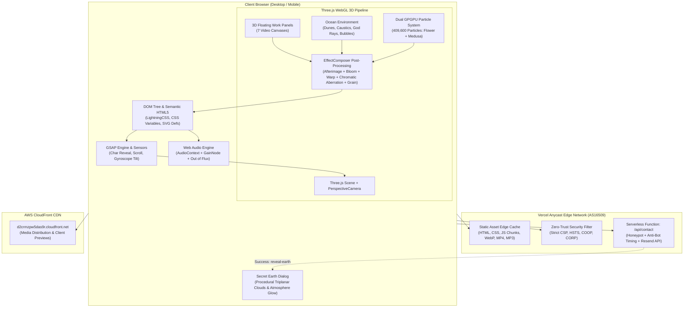
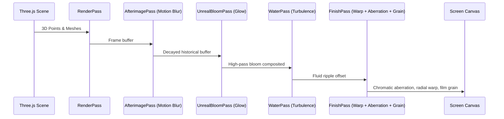

# System Architecture Specification: Next Label Design Studio

This document provides a comprehensive production architectural specification of [Next Label](https://imranhossain.dev/).

---

## 1. Executive Summary & Architectural Overview

**Next Label** is an ultra-high-end Japanese creative web design studio site embodying the concept:
> **「深海にも四季がある」** (*"Even the deep sea has four seasons"*)  
> *"Mix the unexpected: Folding a cosmos flower into a deep-sea jellyfish."*

The architecture combines static high-performance Edge delivery with cutting-edge real-time 3D WebGL computer graphics, GPU-based GPGPU particle simulations (409,600 particles), interactive Web Audio, and zero-latency micro-interactions.

---

## 2. Pinned Technology & Dependency Inventory

| Domain | Technology | Version / Standard | Role & Implementation |
| :--- | :--- | :--- | :--- |
| **Bundler & Tooling** | Vite + LightningCSS | Modern ES Modules | Zero-runtime bundling, CSS variable compiling, code-splitting |
| **3D Rendering** | Three.js | r160+ (Tree-shaken) | Scene management, camera rig, point clouds, shaders, post-processing |
| **Post-Processing** | Three.js Postprocessing | Standard / Custom | `EffectComposer`, `RenderPass`, `AfterimagePass`, `UnrealBloomPass`, Custom `ShaderPass` |
| **Animation Engine** | GSAP (GreenSock) | v3.12+ | Text reveal splitting (`chars`), sweep, timeline choreography, scroll synchronization |
| **Audio Processing** | Web Audio API | W3C Standard | `AudioContext`, ambient soundtrack loop, gain smooth fading |
| **Typography** | Google Fonts & Japanese Noto/Mincho | Variable / WOFF2 | *Shippori Mincho*, *Zen Kaku Gothic New*, *Instrument Serif* |
| **Cloud & Hosting** | Vercel Edge Network | Anycast (AS16509) | Global edge caching, HTTP/2, Brotli/Gzip compression, TLS 1.3 |
| **Backend Compute** | Vercel Serverless Function | Node.js / Edge runtime | `/api/contact` endpoint with honeypot and timing heuristics |
| **External CDN** | AWS CloudFront | Anycast Distribution | `d2crmzpw5das9r.cloudfront.net` media hosting |
| **Security Layer** | W3C Level 3 CSP & HSTS | Strict-Origin | Zero third-party scripts, `default-src 'self'`, no tracking cookies |

---

## 3. Core Architecture & Subsystems

### 3.1 Dual-Particle Simulation Engine (Flower & Medusa)
- **High-Tier GPU**: 512×512 (Flower: 262,144) + 384×384 (Medusa: 147,456) = **409,600 active particles**.
- **Low-Tier GPU / Mobile**: 256×256 (65,536) + 192×192 (36,864) = **102,400 active particles**.
- **Seasonal Particle Modes**:
  1. `seasonsRing`: `VORTEX` particle ring.
  2. `sakuraFall`: `FALL` Sakura blossom drift (Spring).
  3. `hanabi`: `NETWORK` Fireworks particle burst (Summer).
  4. `mapleFall`: `FALL` Momiji maple leaf drift (Autumn).
  5. `snowFall`: `FALL` Sub-zero crystal snowfall (Winter).
  6. `medusa`: `JELLY` Sine-wave hydrodynamic swimming propulsion.

### 3.2 Ocean & Abyss Environment
- **Seabed Dunes & Caustics**: Custom vertex/fragment shader generating procedural FBM sand ripples and animated lighting caustics (`fbm(vWorld.xz * 0.25 - vec2(uTime * 0.08, ...))`).
- **Underwater God Rays**: Linear depth light shafts simulating volumetric sunlight penetrating deep water.
- **Glass Bubble System**: Procedural point-sprites with sharp specular highlights and fresnel rims.
- **Abyss Starfield**: Background twinkling particles with variable flicker frequencies.

### 3.3 Post-Processing Pipeline

### 3.4 Contact Form & Secret Earth Easter Egg
1. User enters Name, Email, and Message.
2. Bot trap: Hidden `company_website` honeypot.
3. Bot timing trap: `elapsed < minFillMs (3000ms)` or `sentRecently()` locally rejects automated bots.
4. Payload transmitted via `fetch('/api/contact', { method: 'POST', credentials: 'same-origin' })`.
5. On success:
   - Triggers `nextlabel:reveal-earth` custom event.
   - Dynamically loads `SecretEarthPage-DeCha5-M.js` (9.3 KB chunk).
   - Renders interactive procedural 3D Earth in low orbit with triplanar cloud FBM noise and atmospheric rim glow.

---

## 4. Accessibility, Performance & Device Adaptation

- **GPU Tier Detection**: Evaluates WebGL renderer performance string, screen pixel density, and benchmark warm-up frame times.
- **URL Overrides**:
  - `?lite=1`: Halves particle counts, disables heavy post-processing shaders.
  - `?capture=1`: Disables frame-rate smoothing and locks deterministic time steps for video recording.
- **Prefers-Reduced-Motion**: Listens to `(prefers-reduced-motion: reduce)`, freezes rotation matrices, halts chaotic particle drift, and replaces kinetic transitions with instant fades.
- **Zero Third-Party Bloat**: No Google Tag Manager, no Facebook Pixel, no external font trackers. Everything is strictly self-hosted.
