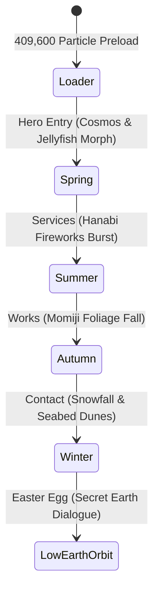

# Motion, Interaction & Shader Mechanics: JUNKBRANDING

This document breaks down the interactive design, kinetic choreography, particle systems, and shader pipelines found on `https://www.junkbranding.com/`.

---

## 1. Seasonal Narrative Motion Choreography

The site transitions through a multi-stage seasonal narrative anchored in Japanese seasonal sensibility:

### 1.1 Spring (春) – Cosmos Flower to Jellyfish Morph
- **Concept**: A high-resolution photograph of a Cosmos flower folds and disintegrates into a swimming translucent jellyfish.
- **Particle Count**: 512×512 (262,144 particles) flower points morphing into 384×384 (147,456 particles) medusa points.
- **Physics**: Sine-wave modulated hydrodynamic propulsion with pulsating bells and trailing tentacles.

### 1.2 Summer (夏) – Hanabi (花火) Particle Network
- **Concept**: Summer fireworks exploding into an interconnected neural constellation.
- **Motion**: Radial outward velocity burst with distance-based connective lines and light trails.

### 1.3 Autumn (秋) – Maple (紅葉) Drift
- **Concept**: Autumn momiji leaves swaying and tumbling through water currents.
- **Physics**: 3D rotation with fluid resistance (`uSway`, `uFall`, `uTravel`).

### 1.4 Winter (冬) – Crystal Snowfall & Deep Ocean Floor
- **Concept**: Sub-zero crystallizing snow falling onto ocean dunes.
- **Shaders**: Procedural sand dunes deformed via FBM noise, animated water caustics, and vertical god rays.

---

## 2. GSAP Choreography & Micro-Interactions

### 2.1 Text Reveal Splitting
The site implements three distinct typographic entrance animations tagged via HTML attributes:

1. `data-reveal="chars"`:
   - Splits typography into individual `` characters.
   - Staggers character opacity from `0` to `1` with a `translateY(12px)` upward drift.
   - Easing: `power2.out`, stagger interval: `0.015s`.

2. `data-reveal="sweep"`:
   - Applies an animated left-to-right clipping mask gradient.
   - Creates a smooth poetic line sweep reminiscent of calligraphy ink.

3. `data-reveal="rise"`:
   - Block-level entrance with `opacity: 0 -> 1` and `y: 40px -> 0px`.

### 2.2 Depth-Based Parallax System
DOM panels and headings contain `data-depth` attributes defining relative parallax displacement velocities:
- `data-depth="0.6"`: Far background labels (slow drift).
- `data-depth="0.8"`: Midground text elements.
- `data-depth="1.0"`: Standard scroll plane (1:1 with camera rig).
- `data-depth="1.2"`: Foreground interactive form fields.
- `data-depth="1.5"`: High-speed floating accent graphics.

---

## 3. WebGL Post-Processing Pipeline

The visual aesthetic relies on custom multi-pass GLSL post-processing executed via `EffectComposer`:

### 3.1 Afterimage & Motion Trail (`AfterimagePass`)
- Retains previous frame buffers with a damping factor (`0.82`).
- Creates luminous organic motion blur behind swimming jellyfish tentacles.

### 3.2 Unreal Bloom (`UnrealBloomPass`)
- Parameters: `Resolution(256, 256)`, `Strength: 0.4`, `Radius: 0.8`, `Threshold: 0.7`.
- Isolates high-luminance particle points to produce a bioluminescent deep-sea underwater glow.

### 3.3 Screen Warp & Chromatic Aberration (`Xh ShaderPass`)
- **Barrel Distortion**: Distorts coordinates radially around screen center:
  $$\text{uv} = 0.5 + c \times (1.0 - \text{uWarp} \times 0.22 \times (0.4 + r^2 \times 2.5))$$
- **Chromatic Aberration**: Offsets RGB channels along the radial vector:
  $$\text{offset} = c \times (\text{uAberration} + \text{uWarp} \times 0.03)$$
  Red samples radially outward, Blue samples radially inward.
- **Film Grain**: Dynamic per-pixel noise based on screen resolution and elapsed time:
  $$\text{grain} = \text{fract}(\sin(\text{dot}(\lfloor\text{uv} \cdot \text{res}\rfloor + \lfloor t \cdot 24.0\rfloor \times 7.13, \mathbf{k})) \times 43758.5453) - 0.5$$

---

## 4. Gyroscope & Mobile Sensor Integration

- Subscribes to `deviceorientation` event listening for `gamma` (left/right tilt) and `beta` (front/back tilt).
- Maps device tilt directly to the Three.js camera rig:
  $$\text{targetRoll} = \text{clamp}(\text{gamma} \times 0.008, -0.3, 0.3)$$
- Enables intuitive physical connection when viewed on iOS and Android handheld devices.
